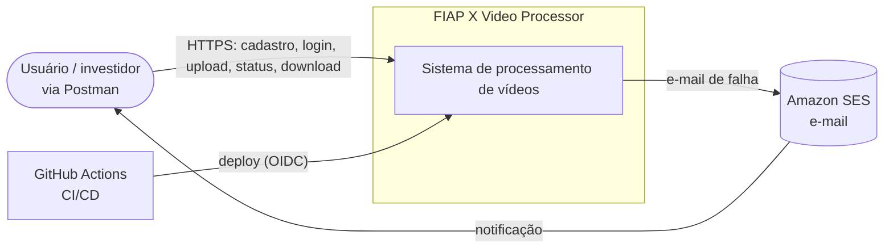
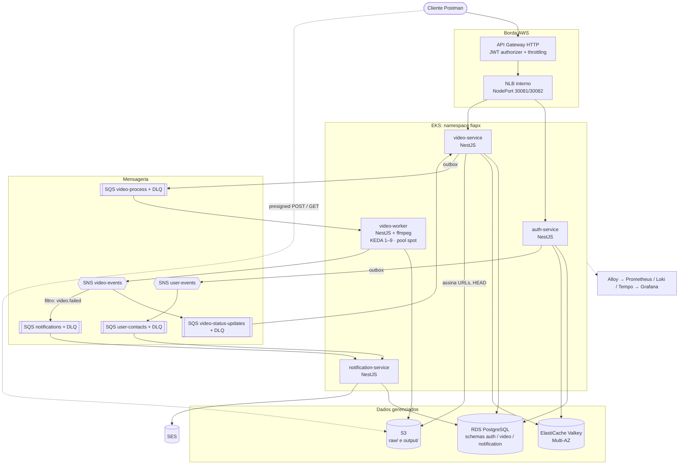
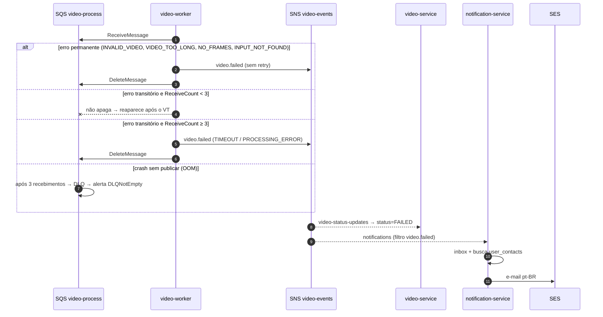
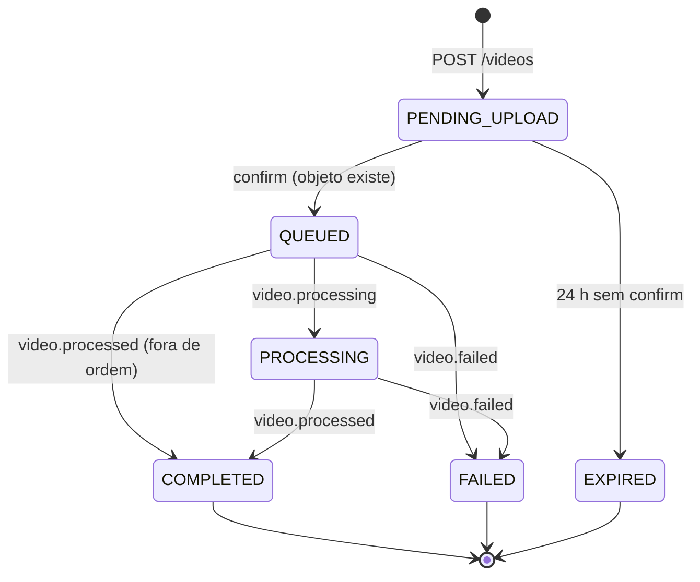
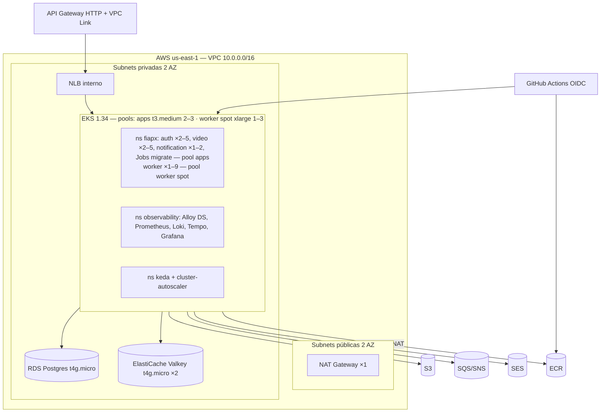

# Diagramas: FIAP X Video Processor

Os diagramas estão em Mermaid e são renderizados pelo GitHub. Para o vídeo, devem ser exportados como PNG para `docs/delivery/assets/`.

## 1. Contexto (C4 nível 1)


## 2. Containers (C4 nível 2)


## 3. Sequência 1: upload, processamento e download (caminho feliz)
```mermaid
sequenceDiagram
  autonumber
  actor U as Cliente
  participant G as API Gateway
  participant V as video-service
  participant DB as Postgres (video)
  participant S3
  participant Q as SQS video-process
  participant W as video-worker
  participant T as SNS video-events
  U->>G: POST /videos {fileName, sizeBytes, contentType, fps}
  G->>V: (JWT válido)
  V->>V: valida JWT, revogação (Redis), entrada
  V->>DB: INSERT videos (PENDING_UPLOAD)
  V-->>U: 201 {videoId, upload: presigned POST}
  U->>S3: POST form-data (≤ 500 MB)
  U->>G: POST /videos/{id}/confirm
  G->>V: confirm
  V->>S3: HeadObject(raw/...)
  V->>DB: TX: status=QUEUED + INSERT outbox
  V-->>U: 202 {status: QUEUED}
  loop relay a cada 1 s
    V->>DB: SELECT outbox FOR UPDATE SKIP LOCKED
    V->>Q: SendMessage(video.process)
    V->>DB: published_at = now()
  end
  W->>Q: ReceiveMessage (long poll)
  W->>T: video.processing
  W->>S3: GetObject raw
  W->>W: ffprobe + janelas ffmpeg → zip streaming
  W->>S3: multipart upload output/.../frames.zip
  W->>T: video.processed
  W->>Q: DeleteMessage
  T-->>V: (via SQS video-status-updates)
  V->>DB: TX: inbox + status=COMPLETED; INCR videos:ver
  U->>G: GET /videos
  V-->>U: 200 [ {status: COMPLETED, frameCount} ]
  U->>G: GET /videos/{id}/download
  V-->>U: 200 {url presigned GET 5 min}
  U->>S3: GET frames.zip
```

## 4. Sequência 2: login, refresh, reuso e logout
```mermaid
sequenceDiagram
  autonumber
  actor U as Cliente
  participant A as auth-service
  participant DB as Postgres (auth)
  participant R as Redis
  U->>A: POST /auth/login
  A->>R: rate limit (fail-closed)
  A->>DB: busca usuário, verifica argon2id
  A->>DB: INSERT session (sid) + refresh_token (hash)
  A-->>U: {accessToken 15 min, refreshToken}
  U->>A: POST /auth/refresh {rt1}
  A->>DB: rt1 válido e não usado? marca used, cria rt2
  A-->>U: {access novo, rt2}
  Note over U,A: atacante reapresenta rt1
  U->>A: POST /auth/refresh {rt1}
  A->>DB: rt1 já usado → sessions.revoked_at (REFRESH_REUSE)
  A->>R: SET revoked:sid:{sid} EX 900
  A-->>U: 401 (sessão revogada; log de segurança)
  U->>A: POST /auth/logout (Bearer)
  A->>DB: revoked_at = now() (LOGOUT)
  A->>R: SET revoked:sid:{sid} EX 900
  A-->>U: 204
  loop a cada 60 s e no boot
    A->>DB: sids revogados nos últimos 15 min
    A->>R: reidrata revoked:sid:*
  end
```

## 5. Sequência 3: falha e notificação


## 6. Estados do vídeo

As transições não listadas, como um `processing` depois de `COMPLETED`, são ignoradas e ficam registradas na inbox.

## 7. Implantação (homolog)

